# LYSHEIM

**Well-made home goods for everyday living.**

LYSHEIM is a home-goods storefront: a portfolio project that models a real, IKEA-inspired retail
business and then builds a production-grade slice of it. It exists to show a recruiter or a freelance
client both **commercial thinking** — a strategy, a scope, priced assumptions — and **senior
engineering execution**: a typed contract, a tested domain, accessible UI, and a deploy that is
verified rather than assumed.

**Live demo — <https://ecommerce-project-five-psi.vercel.app>**

> **Status: Phase 1 (the storefront) is built and deployed.** A shopper can register, browse the
> catalogue, fill a cart, check out against a mock payment provider, and read the order back; an
> operator can manage the catalogue and move an order with the Django admin. Every increment is
> committed with its tests and its evidence; the milestone-by-milestone record is
> [`docs/04-delivery/ROADMAP.md`](docs/04-delivery/ROADMAP.md), and the reasoning behind each
> decision is in [`docs/decisions/`](docs/decisions/).

## What a shopper can do

The journey the screenshots below walk, in order:

1. **Register or sign in.** Access token in memory, refresh token in an httpOnly cookie scoped to the
   auth routes, with rotation and reuse detection (`ADR-0009`).
2. **Browse and search** 46 products across 7 categories — filters, price range, sort, and paging,
   all carried in a shareable URL.
3. **Read a product page** — gallery, per-variant price and stock, and add to cart with a colour
   choice.
4. **Fill a cart**, stock-capped on the server and behind the bearer token (`ADR-0017`).
5. **Check out**: address → shipping → payment → confirmation, in one route. The mock provider's
   *both* outcomes are reachable, so the failure path is exercised rather than hoped for.
6. **Read the order back** — a history at `/orders` and a receipt with its `OrderEvent` timeline at
   `/orders/[number]`, both scoped to the caller by the query itself.
7. **Sign out** without leaving a live refresh token behind.

An operator, separately, gets the Django admin at `/admin/`: catalogue and stock with inline images,
order status moved only through guarded actions that write their own audit event, and the low-stock
queue (`US-5.3`). [`docs/04-delivery/RUNBOOK.md`](docs/04-delivery/RUNBOOK.md) §9 is how an operator
account is made.

## Screenshots

Captured from a real session against the running app by the Playwright journey in
[`frontend/e2e/journey.spec.ts`](frontend/e2e/journey.spec.ts) — not mocked up. The data is the
seeded demo set.

### Browsing

| | |
| --- | --- |
| 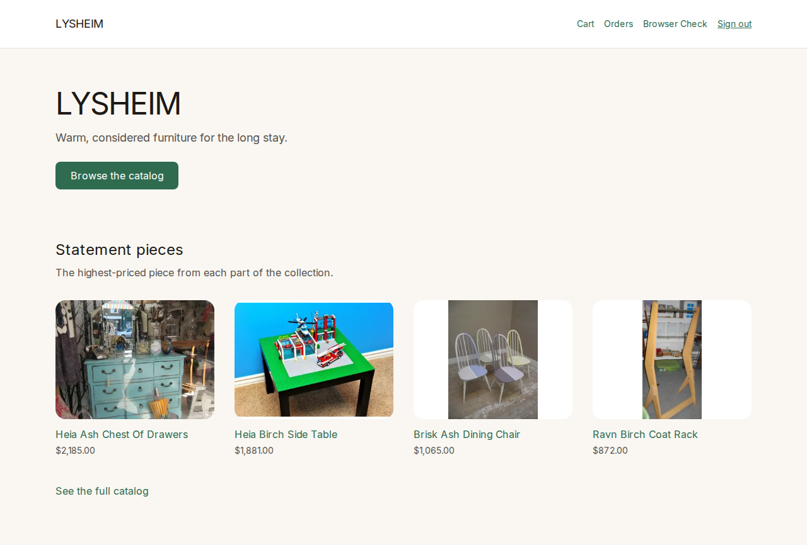 | 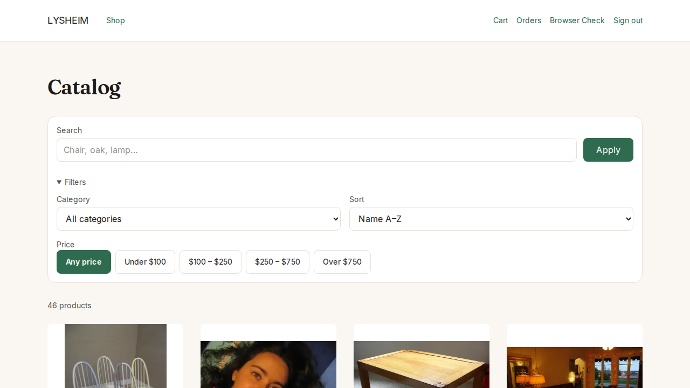 |
| **Home** — hero and featured row, the featured list streamed behind a Suspense boundary. | **Catalogue** — filters, price range, sort and paging, all in the URL. |
| 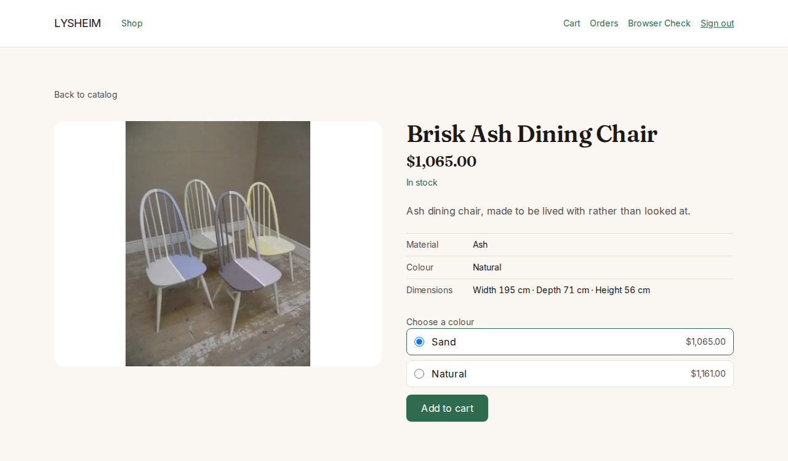 | 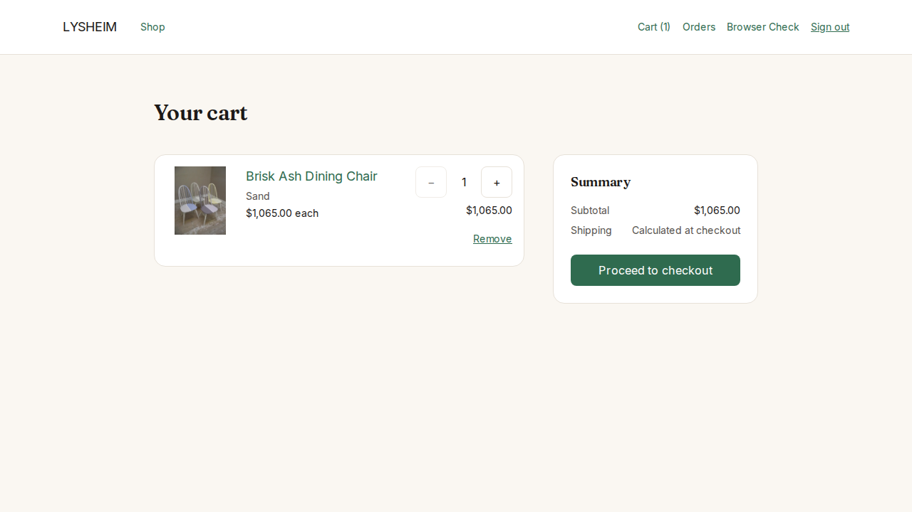 |
| **Product** — gallery, per-variant price and availability. | **Cart** — server-validated quantities, capped at stock. |

### Accounts

| | |
| --- | --- |
| 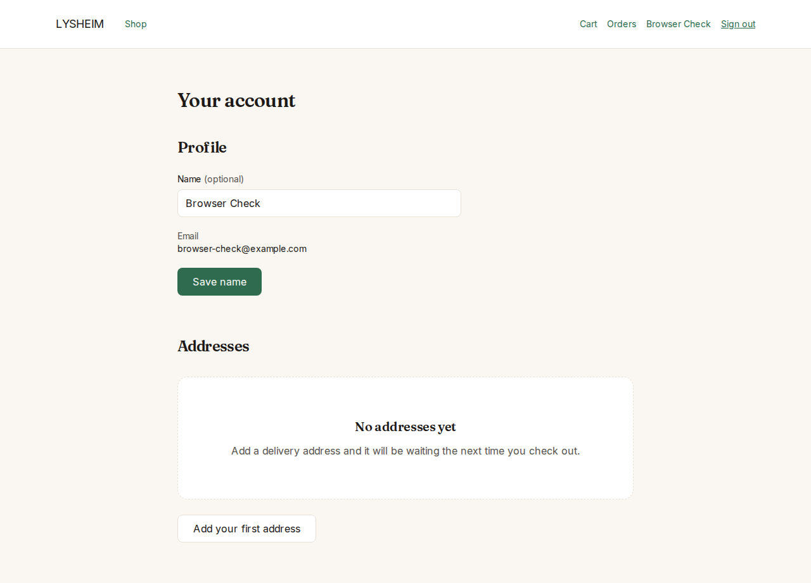 | |
| **Account** — one route with two sections, restoring state rather than a signed-out flash. | |

### Checkout

| | | |
| --- | --- | --- |
| 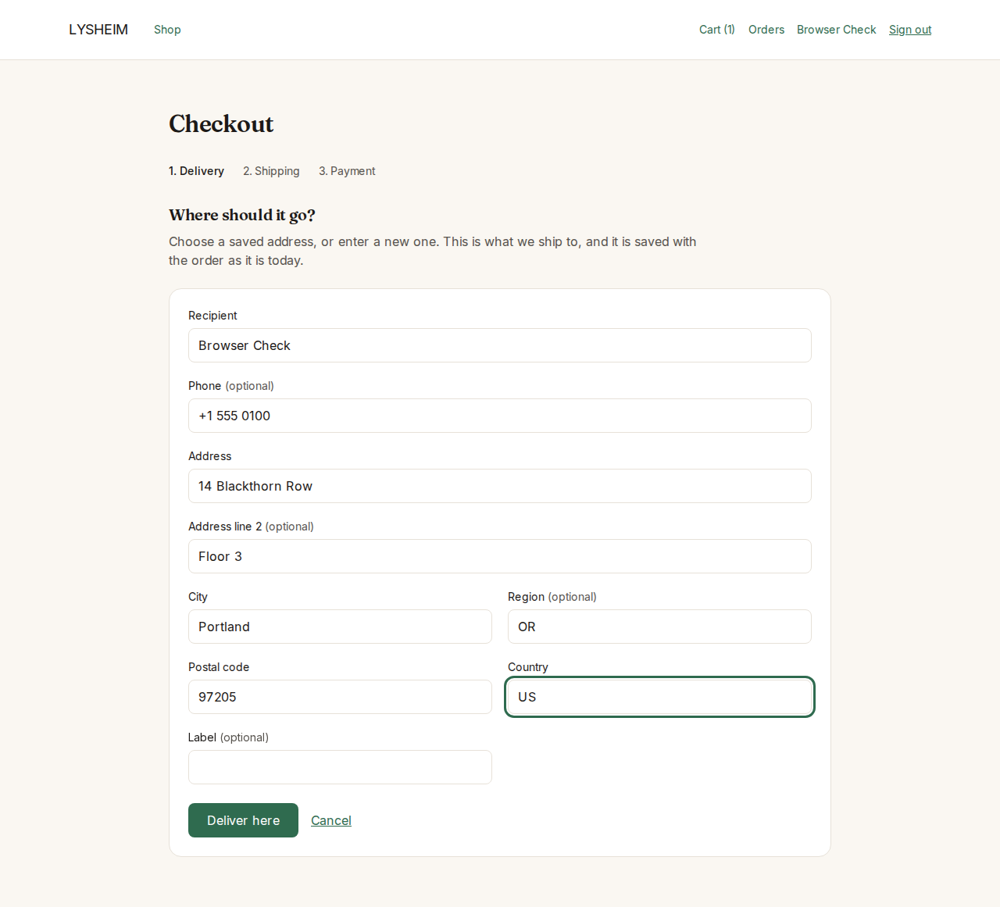 | 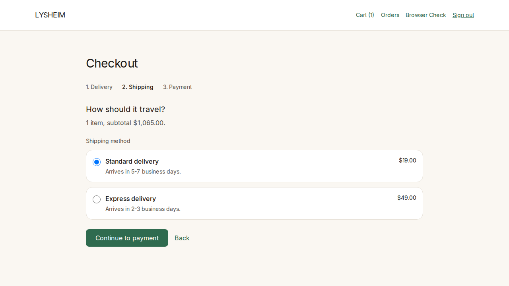 | 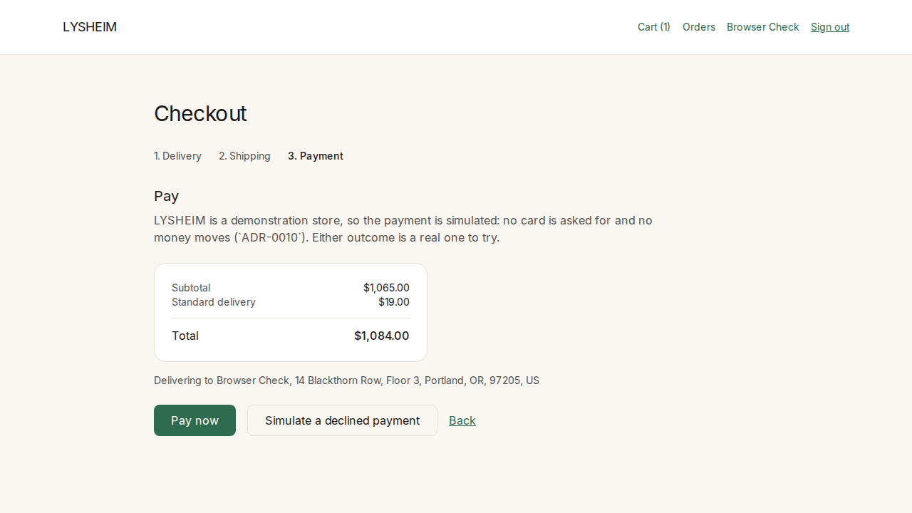 |
| **Address** — a saved address or the address book's own form. | **Shipping** — the API's options, each with the total it produces. | **Payment** — the review, then the mock's outcome. |
| 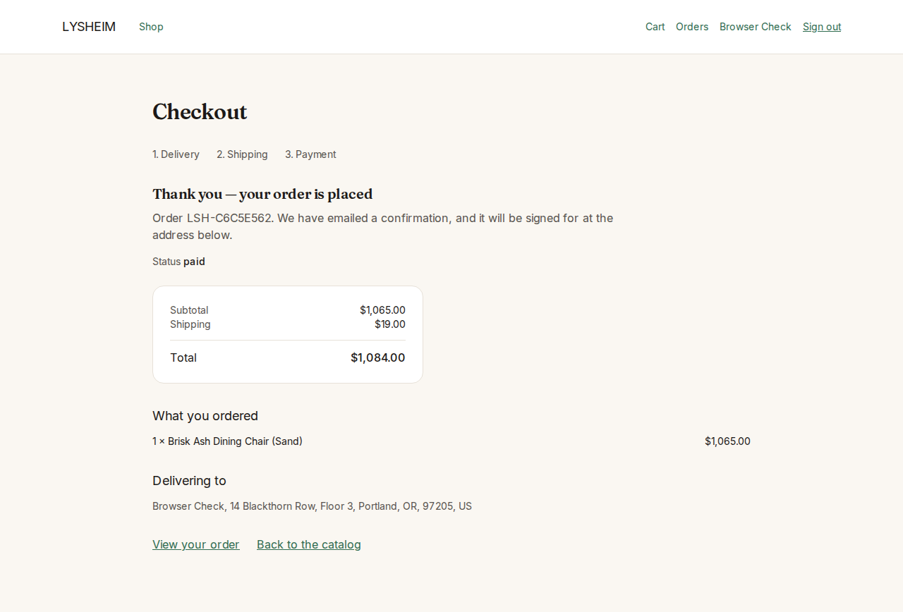 | | |
| **Confirmation** — the order's own status, which the capture decided. | | |

### The order, read back

| | | |
| --- | --- | --- |
| 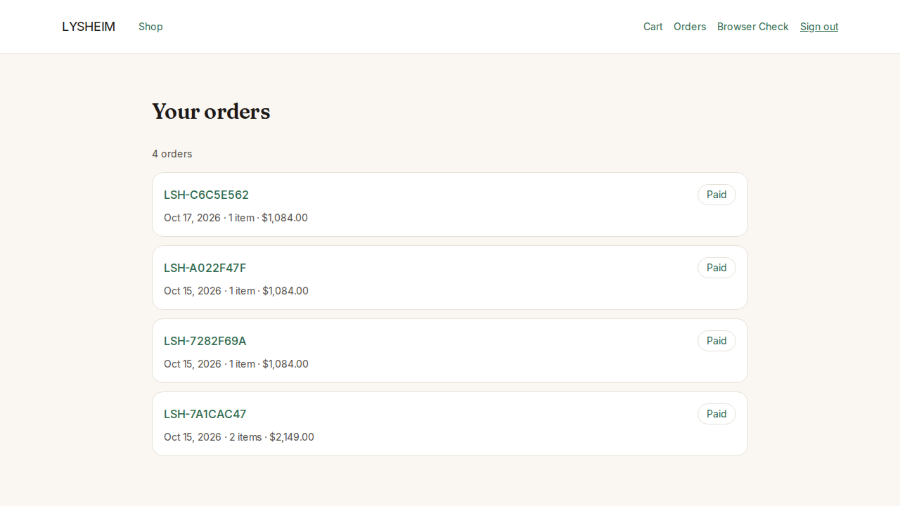 | 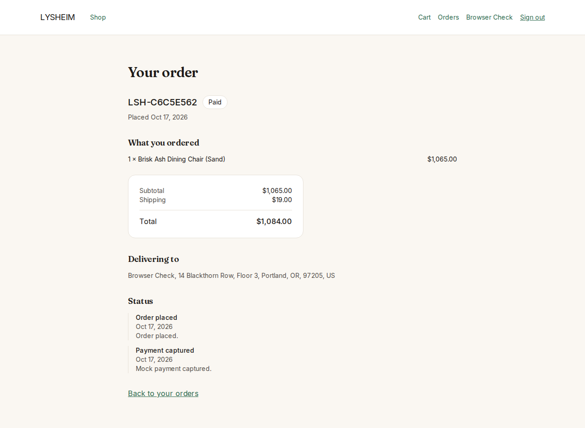 | |
| **History** — number, date, status, line count, total. | **Detail** — the receipt plus the timeline that says how the order got where it is. | |

### The operator console

| | | |
| --- | --- | --- |
| 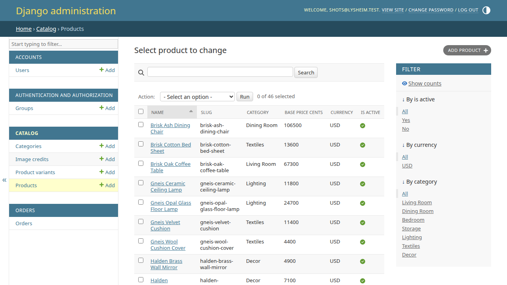 | 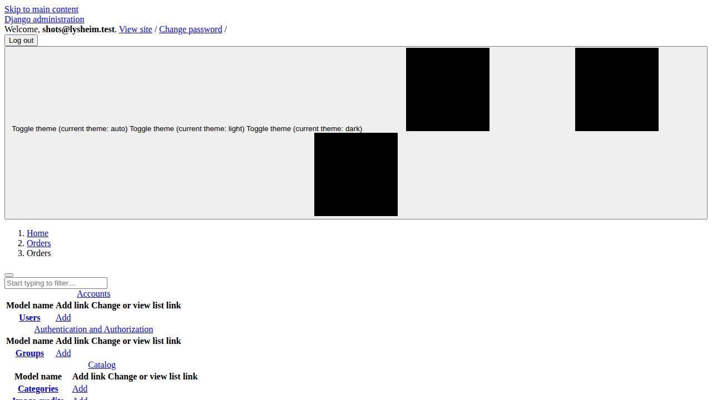 | 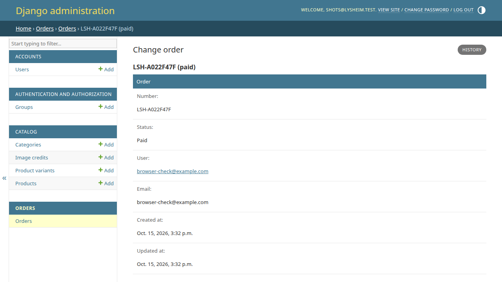 |
| **Products** — filters, search and the low-stock indicator. | **Orders** — filtered by status and date. | **One order** — a read-only receipt whose status moves only through guarded actions. |

The console needs an operator account, so these three come from a run against the same seed data
locally; the public demo has no operator provisioned. The spec that captures them skips unless
credentials are supplied, rather than inventing one:

```bash
cd frontend
ADMIN_EMAIL=you@example.com ADMIN_PASSWORD=… CONSOLE_BASE_URL=http://127.0.0.1:8000 \
  SHOTS_DIR=../docs/assets/screenshots pnpm console:audit
```

## Architecture

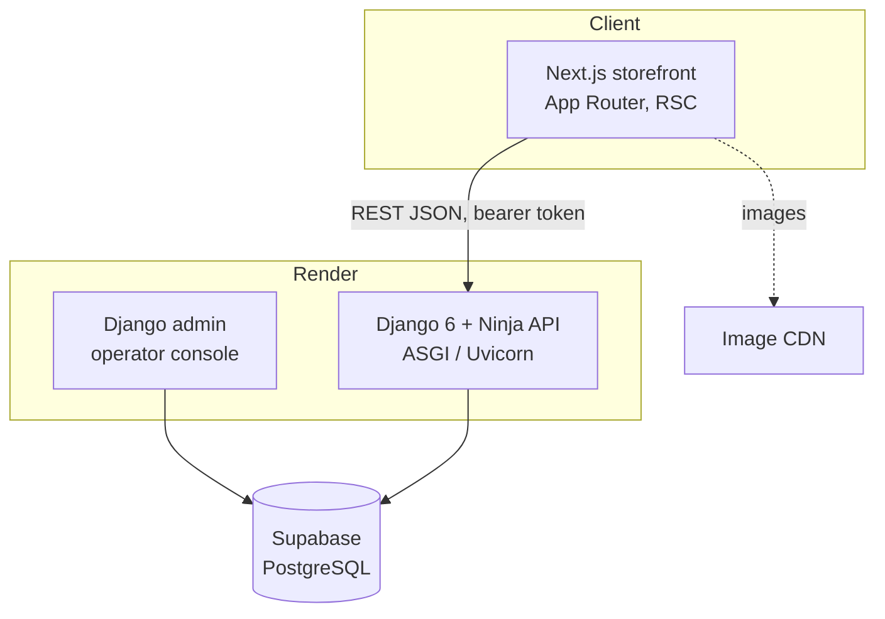

| Container | Responsibility | Technology | Hosted on |
| --- | --- | --- | --- |
| Storefront | Catalogue, account, cart, checkout, orders | Next.js (App Router, RSC, TypeScript strict) | Vercel |
| API | Domain logic, auth, REST endpoints, off-request jobs | Django 6 + Django Ninja (ASGI) | Render |
| Database | System of record | PostgreSQL | Supabase |
| Console | Catalogue, stock and order management | Django admin (server-rendered) | Render |

A few decisions worth naming, all argued in full in [`docs/decisions/`](docs/decisions/):

- **The contract is generated, not hand-written.** The API's OpenAPI schema is committed as
  `frontend/openapi.json` and the frontend's types are generated from it, with a drift check in CI —
  so a backend change that breaks the client fails the build that made it.
- **Orders snapshot; carts reference.** An order copies the product, variant and address, so editing
  a product cannot rewrite history; a cart uses `PROTECT`, so withdrawing a variant cannot silently
  empty it.
- **One active cart per user, by partial unique index**, and stock moved under a conditional update
  inside the transaction that writes the order, so a decline cannot leak a reservation.
- **Payments are a port with a mock adapter** (`ADR-0010`); the real provider replaces the adapter,
  not the checkout.
- **The catalogue is read-only to the public and images are credited.** Every shipped photograph is
  attributed from the database at `/pages/credits`, with licence codes linked to their deeds
  (`ADR-0012`).

## Quality evidence

Evidence, not adjectives. Each of these is a committed artefact with the numbers in it:

| Report | What it holds |
| --- | --- |
| [`A11Y-PERF-REPORT.md`](docs/06-quality/A11Y-PERF-REPORT.md) | 11 routes audited at WCAG 2.1 `AA` with axe in a real browser; LCP 1 508 ms against the 2 500 ms budget; 159 KiB of first-load JS against 200 KiB; API p95 48.6 ms against 300 ms. |
| [`SECURITY-REVIEW.md`](docs/06-quality/SECURITY-REVIEW.md) | The `SECURITY-BASELINE.md` findings walked one by one: CSP, HSTS and hardening headers, CORS, throttling on every state-changing route, a secret guard, and dependency audits wired into CI. |
| [`RUNBOOK.md`](docs/04-delivery/RUNBOOK.md) §7.10 | The production smoke journey and both audits run against the **deployed** hosts, not a local server: 17 of 17 pass. |
| [`CHANGE-LOG.md`](docs/CHANGE-LOG.md) | Per increment: what changed and why, including the bugs found by pointing the audit outward. |

Tests: **359 backend** (`pytest`, 98.9% line coverage on the measured domain scope against the 80%
floor the gate enforces) and **163 frontend** (Vitest, including axe component tests). CI runs the
same gates on every push.

## Stack

- **Backend:** Python · Django 6 · Django Ninja · PostgreSQL · `uv` · `ruff` · `basedpyright`
- **Frontend:** Next.js (App Router, TypeScript strict) · Tailwind CSS · `pnpm` · ESLint · Prettier
- **Testing:** `pytest` + `pytest-cov` · Vitest + Testing Library + axe · Playwright
- **Delivery:** Docker Compose (local) · GitHub Actions (CI) · Render · Vercel · Supabase

## Run it locally

The whole stack, one command:

```bash
docker compose up
```

Storefront at <http://localhost:3000>, API at <http://localhost:8000> (`/healthz`, `/api/v1/products`).

Without Docker, the two apps separately:

```bash
# API — needs a reachable PostgreSQL
cd backend
uv sync
uv run python manage.py migrate
uv run python manage.py seed          # idempotent; --reset rebuilds the demo data
uv run uvicorn config.asgi:application --port 8000

# Storefront
cd frontend
pnpm install
pnpm dev                              # regenerates the API types, then serves
```

The gates CI runs, and how to run them by hand, are in
[`docs/04-delivery/RUNBOOK.md`](docs/04-delivery/RUNBOOK.md) §3.

## What is deliberately not here

Scope is a decision, not an omission, and the reasoning is recorded:

- **No guest cart and no login merge.** The first add requires sign-in, which deletes a whole class of
  merge conflicts and stale-cookie bugs (`ADR-0017`).
- **No real payment provider.** Settling is mocked end to end, both outcomes reachable (`ADR-0010`).
- **No analytics/event pipeline yet.** That is Phase 2 (`M8`), and its ADRs are written when it starts.
- **No microservices, no queue, no Kubernetes.** One API and one database is the honest shape at this
  size; the order-confirmation email goes through Django's Tasks framework so a queue can replace the
  backend without touching the call site.

## The free-tier trade

**The first visit is slow, and that is the trade rather than a fault.** The API and database are on
free tiers that sleep when idle, so the first request after a quiet spell can take tens of seconds.
Measured 2026-10-12: first page load 48 s, next 2 s; a single route 28 s on its own first hit; the API
1 s once awake. `ADR-0011` accepts that as the price of the free tier, and the mitigation is a
ten-minute keep-alive that pings both hosts and fails if either stops answering
([`.github/workflows/keepalive.yml`](.github/workflows/keepalive.yml)). One patient load, and
everything after it is quick.

## Documentation

The documentation is a first-class deliverable, not an afterthought. Start here:

- [`docs/PLAN.md`](docs/PLAN.md) — the living master plan and the evidence gates
- [`docs/01-business/STRATEGY.md`](docs/01-business/STRATEGY.md) — market, model, positioning
- [`docs/02-product/SCOPE.md`](docs/02-product/SCOPE.md) — the user stories and non-functional targets
- [`docs/03-architecture/ARCHITECTURE.md`](docs/03-architecture/ARCHITECTURE.md) — C4 views and the domain
- [`docs/03-architecture/API.md`](docs/03-architecture/API.md) — the HTTP contract
- [`docs/04-delivery/ROADMAP.md`](docs/04-delivery/ROADMAP.md) — milestones, increments and status
- [`docs/04-delivery/RUNBOOK.md`](docs/04-delivery/RUNBOOK.md) — how to run, verify and operate it
- [`docs/04-delivery/RISK-REGISTER.md`](docs/04-delivery/RISK-REGISTER.md) — the risks and their state
- [`docs/06-quality/`](docs/06-quality/) — accessibility, performance and security evidence
- [`docs/decisions/`](docs/decisions/) — architecture decision records
- [`docs/CHANGE-LOG.md`](docs/CHANGE-LOG.md) — every increment, and every milestone retrospective

## Repository layout

```
backend/     Django + Ninja API, its domain tests, and the operator console
frontend/    Next.js storefront, component tests, and the Playwright audits
docs/        business, product, architecture, delivery, quality, and ADRs
```

---

Built solo, in continuous increments, with the reasoning committed alongside the code
([`docs/WORKING-AGREEMENT.md`](docs/WORKING-AGREEMENT.md)).
